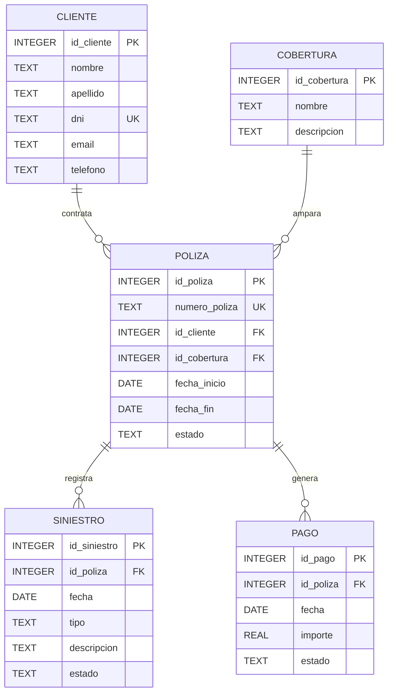

# Sistema Web de Seguros de Accidentes Personales (TIC)

**Institución:** ISFT N.º 199  
**Carrera:** Tecnicatura Superior en Ciencia de Datos e Inteligencia Artificial  
**Materia:** Análisis y Explotación de Datos  
**Alumno:** Sebastian Nicolas Rovetta  

---

## 1. Descripción del Sistema

### ¿Qué hace el sistema?
Es una aplicación web de gestión integral diseñada para administrar asegurados, pólizas de Accidentes Personales (AP), planes de cobertura, control de cobranzas y siniestros denunciados, visualizando métricas operativas y evolución de casos en un panel de control interactivo.

### ¿Quién lo utiliza?
Personal administrativo de la compañía de seguros, analistas de riesgo/siniestros y directivos que requieren consultar estadísticas de siniestralidad y vigencia de cartera.

### ¿Qué datos necesita guardar?
1. **Clientes:** Nombre, apellido, DNI, datos de contacto (email y teléfono).
2. **Coberturas:** Denominación y descripción de alcances (Laboral, 24hs, Deportivo, In Itinere, Integral).
3. **Pólizas:** Identificador único (`numero_poliza`), cliente tomador, cobertura seleccionada, fecha de inicio, vencimiento y estado.
4. **Siniestros:** Póliza afectada, fecha del hecho, tipo de siniestro (caída, fractura, tránsito, etc.), descripción y estado del caso (ABIERTO, EN PROCESO, CERRADO).
5. **Pagos:** Póliza imputada, fecha, importe abonado y estado de la cobranza.

### ¿Qué operaciones permite?
- **CRUD completo** (Crear, Consultar, Modificar y Dar de Baja) sobre Clientes, Pólizas y Siniestros.
- Búsqueda en tiempo real de asegurados por nombre, apellido o DNI.
- Emisión de pólizas seleccionando asegurados existentes.
- Registro de siniestros imputados a pólizas vigentes y alternancia ágil entre estados (Abierto / Cerrado).

### ¿Qué información es útil analizar?
- Cantidad de asegurados totales y pólizas activas vs. vencidas/canceladas.
- Siniestros pendientes de resolución (Abiertos) vs. casos concluidos.
- Distribución de siniestralidad por tipo de contingencia más frecuente.
- Estacionalidad o evolución cronológica de siniestros por mes.

---

## 2. Diagrama Entidad-Relación (DER)



### Justificación de Normalización (3FN)
- **1FN:** Todos los atributos son atómicos y no existen grupos repetitivos.
- **2FN:** No existen dependencias funcionales parciales; cada atributo no clave depende de la totalidad de la clave primaria.
- **3FN:** No existen dependencias transitivas. Por ejemplo, los datos del cliente residen exclusivamente en `cliente`; la póliza solo referencia a `id_cliente`. Las coberturas se aislaron en `cobertura` para evitar replicar nombres y descripciones en cada póliza. Los pagos y siniestros dependen exclusivamente de la póliza contratada.

---

## 3. Bitácora de Inteligencia Artificial (5 Prompts Relevantes)

| N° | Prompt Solicitado | Respuesta Obtenida de la IA | Corrección / Ajuste Realizado | Aprendizaje Obtenido |
|---|---|---|---|---|
| **1** | *"Generá el esquema DDL normalizado en 3FN para un sistema de seguros de accidentes personales con cliente, poliza, siniestro, pago y cobertura en SQLite."* | Creó las sentencias `CREATE TABLE` con tipos SQLite y foreign keys. | Se agregaron restricciones de integridad estrictas (`CHECK(estado IN (...))`, `ON DELETE RESTRICT` y unicidad en DNI y número de póliza). | SQLite requiere habilitar `PRAGMA foreign_keys = ON;` explícitamente para validar claves foráneas en tiempo de ejecución. |
| **2** | *"Creá un seed de datos SQL coherente con al menos 10 clientes, 10 pólizas, 5 coberturas, 15 pagos y 10 siniestros donde coincidan las fechas."* | Generó sentencias `INSERT INTO` con datos plausibles del mercado argentino. | Se verificó que las fechas de los siniestros estuvieran comprendidas dentro del rango de vigencia (`fecha_inicio` y `fecha_fin`) de cada póliza asignada. | La consistencia temporal en bases relacionales es crucial para evitar siniestros huérfanos o con fechas fuera de vigencia. |
| **3** | *"¿Cómo configurar una conexión universal en Next.js compatible tanto con SQLite local (`seguros.db`) como con Turso en Vercel?"* | Sugirió utilizar la librería oficial `@libsql/client` pasando `TURSO_DATABASE_URL` y fallback a `file:seguros.db`. | Se encapsuló la instancia en `lib/db.ts` utilizando `process.cwd()` para localizar el archivo `.db` en entornos de desarrollo local. | `@libsql/client` unifica el protocolo libSQL/SQLite sin requerir binarios nativos de C++ que suelen fallar al compilar en Vercel. |
| **4** | *"Escribí las consultas SQL para los KPIs del Dashboard y la agrupación por mes y tipo de siniestro en SQLite."* | Proveyó consultas `COUNT(*)`, `GROUP BY tipo`, y propuso funciones de fecha. | Se utilizó `strftime('%Y-%m', fecha)` para garantizar que el agrupador mensual ordene cronológicamente y sea ligero. | SQLite maneja fechas como cadenas ISO 8601 (`YYYY-MM-DD`), facilitando el agrupamiento por mes con funciones nativas. |
| **5** | *"¿Cómo estructurar las Server Actions de Next.js para ejecutar `INSERT`, `UPDATE` y `DELETE` reflejando el cambio inmediato en la interfaz?"* | Propuso funciones `async` con directiva `"use server"` y uso de `revalidatePath()`. | Se agregaron validaciones de eliminación protegida (`try/catch` para capturar errores de FK activa) y refresco simultáneo de `/` y la ruta específica. | Las Server Actions simplifican la arquitectura al no requerir endpoints API dedicados (`route.ts`) para cada formulario. |

---

## 4. Guía de Ejecución Local y Despliegue

### Ejecución Local
1. Ingresar a la carpeta de la app:
   ```bash
   cd seguros-web
   ```
2. Iniciar el servidor de desarrollo:
   ```bash
   npm run dev
   ```
3. Abrir en el navegador [http://localhost:3000](http://localhost:3000).

### Despliegue en Vercel + Turso
1. **Crear base en Turso (opcional para persistencia en nube):**
   ```bash
   turso db create tic-seguros
   turso db shell tic-seguros < ../schema.sql
   turso db shell tic-seguros < ../seed.sql
   turso db tokens create tic-seguros
   ```
2. **Subir a GitHub:**
   Crear el repositorio en GitHub y hacer push del código.
3. **Deploy en Vercel:**
   Importar el repositorio en [Vercel](https://vercel.com), seleccionar el directorio raíz del proyecto (`seguros-web`), y agregar las variables de entorno:
   - `TURSO_DATABASE_URL`: URL provista por Turso (ej: `libsql://tic-seguros-usuario.turso.io`)
   - `TURSO_AUTH_TOKEN`: Token provisto por Turso.
